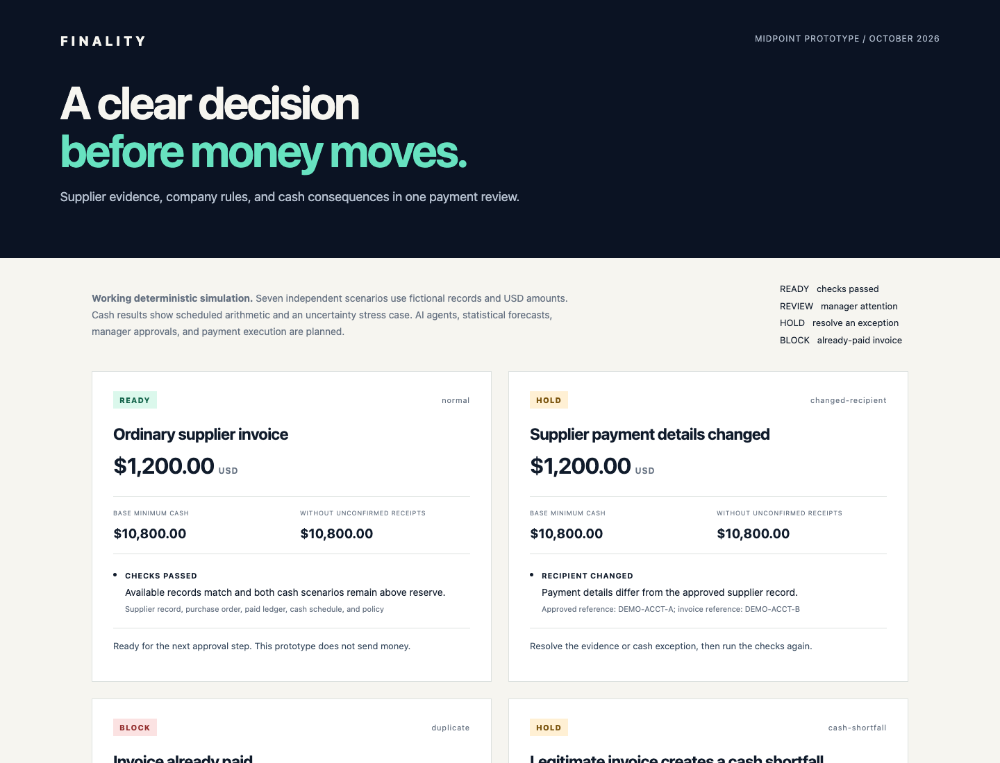
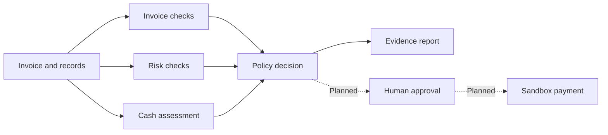

<div align="center">

# FINALITY

### A clear decision before money moves.

Evidence-based supplier payment review.

**Working midpoint prototype · Synthetic data · IBM agent integration planned**

[Midpoint submission](docs/IBM-MIDPOINT.md) · [Architecture](docs/ARCHITECTURE.md) · [Research](docs/RESEARCH.md) · [Demo guide](docs/DEMO.md)

</div>



A familiar supplier. A plausible invoice. A different bank account.

FINALITY brings supporting records, recipient checks, company rules, and cash consequences into one review. Each finding explains the evidence and the next step. The working prototype uses deterministic checks. The proposed agent layer will automate document interpretation and evidence gathering.

## See it in one minute

```bash
python3 -m finality
```

Open **[the offline demo report](artifacts/demo-report.html)** locally after cloning or downloading the repository. GitHub displays the HTML source rather than running it. No credentials, dependencies, or bank access are required. Python 3.9 or later runs the simulation.

| Scenario | Result | Evidence |
| --- | --- | --- |
| Ordinary supplier invoice | READY | Matching records and sufficient projected cash |
| Changed recipient | HOLD | Invoice account differs from the approved supplier record |
| Already-paid invoice | BLOCK | Supplier and invoice number match the paid ledger |
| Cash shortfall | HOLD | Projected cash falls to $4,000 against a $5,000 reserve |
| Missing purchase order | REVIEW | Supporting evidence is unavailable |
| Approval threshold | REVIEW | Payment reaches the manager approval limit |
| Uncertain receipt | REVIEW | Cash sufficiency depends on an unconfirmed incoming payment |

READY means the demonstrated checks passed. This prototype does not authorize or execute transfers. Every scenario runs independently.

## Why this problem matters

AFP's 2026 survey reports attempted or actual payment fraud at **76% of respondents' organizations** in 2025. Separately, the Federal Reserve Banks' 2026 small-business report shows **50% of surveyed employer firms faced uneven cash flow**. These describe distinct populations and support the relevance of payment review, not a claim about FINALITY's effectiveness. [Sources and limitations](docs/RESEARCH.md).

## The framework

**Intake → Evidence → Assessment → Decision → Record**

Invoice checks compare supporting records. Risk checks compare trusted recipient details and flag unusual amounts. Treasury checks calculate base and stress cash scenarios. Policy rules assemble a decision with explicit precedence. The target architecture separates AI recommendations from enforceable payment authority.



[Component contracts and IBM integration plan](docs/ARCHITECTURE.md).

## What exists today

A dependency-free Python review engine, seven synthetic cases, evidence-linked decisions, an offline report, and tests. Cash results use scheduled arithmetic and a stress case without unconfirmed receipts. No statistical forecast or fraud classifier is trained. No autonomous agent or IBM service is connected yet.

The next milestone adds document extraction and specialist agents using IBM tools, subject to access. Agent-assisted review will be compared against this rules-only baseline. [Build and evaluation plan](docs/BUILD-PLAN.md).

## Positioning

Ramp and BILL already offer invoice automation and controls. Float offers cash forecasts. FINALITY explores a lightweight review workflow for users who still assemble those checks manually. Its differentiation is a hypothesis to validate, not a claim of first invention. [Competitive comparison](docs/RESEARCH.md#existing-solutions).

## Run the checks

```bash
python3 -m unittest discover -s tests -v
```

The tests exercise scenario decisions, financial arithmetic, duplicate precedence, threshold boundaries, currency mismatches, cash-event timing, escaping, and input immutability. Curated synthetic cases are acceptance tests, not real-world fraud benchmarks.

## Project materials

- [Presentation PDF](output/pdf/FINALITY-Midpoint-Presentation.pdf)
- [Three-page submission brief](output/pdf/FINALITY-Midpoint-Brief.pdf)
- [Midpoint submission text](docs/IBM-MIDPOINT.md)
- [Presenter notes](docs/PRESENTER-NOTES.md)
- [Three-minute demo walkthrough](docs/DEMO.md)
- [Research and documented incident](docs/RESEARCH.md)
- [Architecture and component contracts](docs/ARCHITECTURE.md)
- [Implementation roadmap and evaluation](docs/BUILD-PLAN.md)
- [Implemented versus planned](docs/STATUS.md)

Personal educational project by Sanskriti Aripineni, prepared for the IBM SkillsBuild AI Experiential Learning Lab. IBM does not endorse this project. All business records are fictional.
