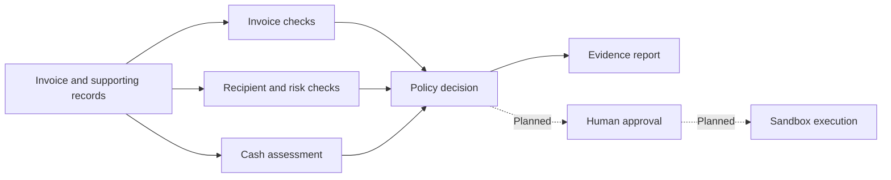

<div align="center">

# FINALITY

### A clear decision before money moves.

Supplier payment review grounded in evidence and cash consequences.

**Research prototype** · **Synthetic data** · **Python 3.9+**

[Project brief](docs/PROJECT-BRIEF.md) · [Architecture](docs/ARCHITECTURE.md) · [Research](docs/RESEARCH.md) · [Roadmap](docs/BUILD-PLAN.md)

</div>


## The payment decision

Before a supplier invoice becomes a payment, someone has to establish that the bill is supported, the recipient is correct, and the company can meet its upcoming obligations.

FINALITY brings those checks into one review. Every finding identifies its supporting evidence and the next action. The current prototype implements deterministic checks and scheduled cash calculations. The proposed agent layer will interpret documents and gather relevant records.

## Why it matters

**Payment fraud is widespread.** AFP's 2026 survey reports that 76% of respondents' organizations experienced attempted or actual payment fraud in 2025. This includes unsuccessful attempts and covers payment fraud broadly. [AFP survey](https://www.financialprofessionals.org/training-resources/resources/survey-research-economic-data/details/payments-fraud).

**Payment timing matters too.** The Federal Reserve Banks' 2026 report finds that 50% of surveyed small employer firms faced uneven cash flow. [Federal Reserve report, printed page 3](https://www.fedsmallbusiness.org/-/media/project/clevelandfedtenant/fsbsite/reports/2026/2026-report-on-employer-firms/2026-report-on-employer-firms.pdf).

These findings describe different populations. They establish the relevance of the problem, while FINALITY's effectiveness remains an evaluation question. [Research and competitive context](docs/RESEARCH.md).

## Review framework

**Intake → Evidence → Assessment → Decision → Record**

| Review area | Question | Evidence |
| --- | --- | --- |
| Invoice | Does the bill match supporting records? | Purchase order and paid-invoice ledger |
| Recipient | Do the payment details match a trusted supplier? | Approved supplier record |
| Cash | Would paying now breach the cash reserve? | Dated obligations and receipt assumptions |
| Policy | What action and approval are required? | Configured approval limits and findings |



[System architecture and component contracts](docs/ARCHITECTURE.md).

## Example outcomes

| Scenario | Decision | Explanation |
| --- | --- | --- |
| Ordinary supplier invoice | **READY** | Supporting records match and cash remains above reserve |
| Changed recipient | **HOLD** | Account differs from the approved supplier record |
| Invoice already paid | **BLOCK** | Supplier and invoice number match the paid ledger |
| Cash shortfall | **HOLD** | Minimum cash reaches $4,000 against a $5,000 reserve |
| Missing purchase order | **REVIEW** | Supporting evidence is unavailable |
| Approval threshold reached | **REVIEW** | Payment requires manager attention |
| Uncertain customer receipt | **REVIEW** | Cash sufficiency depends on an unconfirmed receipt |

READY means the implemented checks passed. It does not authorize a transfer. The seven scenarios run independently against fictional company records.

## Run locally

Clone the repository and run the following from its root with Python 3.9 or later:

```bash
python3 -m finality
```

Open `artifacts/demo-report.html` in a browser to inspect the review results. The command also writes structured JSON findings beside the report. No third-party Python packages or credentials are required. [View the committed report source](artifacts/demo-report.html).

Run the test suite:

```bash
python3 -m unittest discover -s tests -v
```

The tests cover cash arithmetic, decision precedence, threshold boundaries, currency handling, timing assumptions, input immutability, and safe HTML rendering.

## Development status

| Available | Planned |
| --- | --- |
| Structured synthetic invoice inputs | PDF and image document extraction |
| Supplier, order, duplicate, and policy checks | Specialist agents using IBM watsonx services |
| Base and stress cash calculations | Statistical forecasts and risk-model evaluation |
| Evidence report and automated tests | Authenticated approvals and sandbox payments |

[Implementation status](docs/STATUS.md) · [Milestones and evaluation criteria](docs/BUILD-PLAN.md)

## Positioning

Ramp and BILL already offer invoice automation and payment controls. Float offers cash forecasting. FINALITY explores a configurable review workflow for users who still assemble these checks manually. The intended contribution is an understandable decision record that joins supporting evidence with payment consequences. The user need and competitive advantage remain hypotheses to validate.

## Project resources

- [Project brief: idea, value proposition, and AI justification](docs/PROJECT-BRIEF.md)
- [Architecture and agent responsibilities](docs/ARCHITECTURE.md)
- [Research, documented incident, and existing solutions](docs/RESEARCH.md)
- [Implementation roadmap and evaluation](docs/BUILD-PLAN.md)
- [Project brief PDF](output/pdf/FINALITY-Project-Brief.pdf)
- [Presentation PDF](output/pdf/FINALITY-Overview.pdf)
- [Contribution guidelines](CONTRIBUTING.md)

Created by **Sanskriti Aripineni** as a personal educational project in the IBM SkillsBuild AI Experiential Learning Lab. All business records are synthetic. IBM does not endorse this project.
