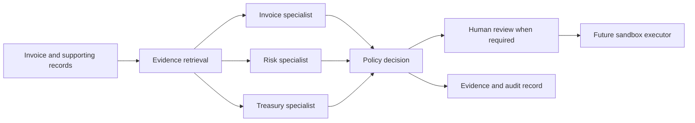

# Solution architecture

## Working framework

FINALITY uses a five-stage payment review: Intake, Evidence, Assessment, Decision, Record. The working prototype accepts structured synthetic invoice records. A future intake adapter will extract fields from documents and retain source references.

The diagram describes the target system. The current implementation provides deterministic checks with the same role labels, not autonomous agents.

## Component contracts

| Component | Inputs | Output | Implementation status |
| --- | --- | --- | --- |
| Intake | Structured invoice JSON | Validated money and date fields | Implemented for required scenario fields |
| Invoice checks | Invoice, purchase order, paid ledger | Evidence matches and duplicate finding | Implemented exact rules |
| Risk checks | Approved supplier account reference, typical amount | Changed-recipient and unusual-amount findings | Implemented rules, no fraud classifier |
| Treasury checks | Starting balance, dated events, proposed payment | Base and stress minimum cash | Implemented scheduled arithmetic |
| Policy | Findings, reserve, approval limit | READY, REVIEW, HOLD, BLOCK | Implemented deterministic precedence |
| Report | Decisions and evidence | HTML and JSON results | Implemented |
| Agent orchestration | Typed tools, model access, retrieved records | Structured specialist findings | Planned |
| Approval service | Authorized reviewer, exact payment, decision revision | Approval bound to request | Planned |
| Payment executor | Current valid approval, idempotency key | Sandbox receipt or reconciled status | Planned |

## Decision rules

Precedence: BLOCK, then HOLD, then REVIEW, then READY. An already-paid invoice is blocked. A changed or unverified recipient, order mismatch, or base cash reserve breach creates a hold. Missing supporting evidence, the approval threshold, unusual amount, or dependence on unconfirmed receipts creates review. READY means the demonstrated checks passed, not permission to transfer money.

Monetary values use integer cents. The prototype supports one company currency per scenario and holds currency mismatches without performing invalid arithmetic. Same-day outflows occur before receipts for a conservative cash projection. Stress mode excludes unconfirmed positive receipts. Each case runs independently. Concurrent spending, cash reservations, daily optimization, currency conversion, and cross-company isolation are future work.

## Target IBM integration

Candidate tools: `lookup_supplier`, `match_purchase_order`, `check_paid_ledger`, `project_cash`, and `evaluate_policy`. watsonx Orchestrate would coordinate specialist agents and tool calls. A watsonx.ai model would extract fields and produce structured explanations grounded in retrieved evidence. Exact services, model IDs, account access, costs, and program eligibility must be confirmed before implementation.

The current prototype makes no external API calls. Model access must come through configuration with no credentials in source control. A service outage must produce an explicit unresolved state, not a fabricated model result.

## Execution boundary

Future approval records should include invoice digest, supplier and recipient references, amount, currency, policy revision, evidence revision, approver identity, and expiry. The executor must recheck material changes and reconcile uncertain payment responses. A changed payment requires a new decision. Only the executor holds payment credentials. Language-model output cannot directly execute payments or rewrite policy.

Use trusted vendor records and an independent contact-verification workflow for recipient changes. Treat uploaded text as data, including instructions embedded in documents. Record observed evidence and decisions rather than private chain-of-thought reasoning.
